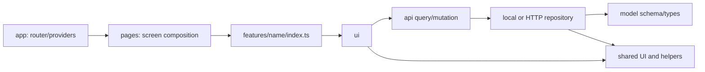

# Frontend Boilerplate

Fondasi React + TypeScript untuk memulai frontend klien dengan cepat dan melanjutkannya ke integrasi backend. Struktur feature-based, 53 modul ui-v1, tema light/dark/system, model/schema terlebih dahulu, adapter lokal/HTTP, ikon SVG, 3D, motion, loading serta panduan AI sudah tersedia.

Halaman awal tetap starter. Contoh koleksi item dan contoh visual berada pada route terpisah sebagai referensi implementasi; tidak menetapkan aplikasi bisnis untuk setiap proyek.

## Mulai

Node >=22.12.0, npm, dan browser modern. Instalasi pertama membutuhkan internet; semua dependency dipatok oleh package-lock.json. Sampel model/font disajikan lokal dan tidak memerlukan API key.

```sh
npm ci
npm run dev
```

Buka URL yang dicetak Vite, biasanya http://127.0.0.1:5173. Jangan memakai npm install dengan --force/--legacy-peer-deps untuk menyembunyikan ketidakcocokan dependency.

| Route             | Isi                                                                                                         |
| ----------------- | ----------------------------------------------------------------------------------------------------------- |
| /                 | halaman awal minimal dan navigasi contoh                                                                    |
| /examples/feature | koleksi item: validasi, tambah, cari/filter, arsip/aktifkan, persistence lokal, pending/loading/error/empty |
| /examples/visual  | GLB/native geometry, kontrol rotasi, motion, loading/skeleton/error/empty, tema dan WebGL fallback          |

## Buat proyek klien

Jalankan dari folder boilerplate. Target harus merupakan direktori baru di luar starter.

```sh
npm run create -- ../nama-proyek "Nama Proyek"
cd ../nama-proyek
npm ci
npm run dev
```

Generator menyalin source, komponen, aset beserta atribusinya, dokumen, skill dan test. Nama package/lockfile/app.config serta title HTML diperbarui. node_modules, dist, hasil pengujian, .git dan environment pribadi tidak disalin. Target yang sudah ada dan target di dalam starter, termasuk lewat symlink, ditolak.

Isi PRODUCT.md/DESIGN.md untuk klien sebelum membuat fitur bisnis. Contoh teknis boleh dipelajari atau dilepas mengikuti [panduan contoh](docs/EXAMPLE_FEATURE.md); primitive bersama tetap tersedia. Perubahan desain, autentikasi, entity, API dan persyaratan deployment tidak boleh diasumsikan dari sampel.

## Struktur folder

```text
frontend-boilerplate/
  src/
    app/                       App.tsx, providers.tsx, routes.tsx
    pages/                     HomePage.tsx, examples/*Page.tsx
    features/
      example-items/
        index.ts               public API
        model/                 schema, tipe inferensi, query keys
        api/                   kontrak, fixtures, local/HTTP adapter, query/mutation
        ui/                    container, form, daftar
        lib/                   helper fitur murni
        __tests__/             contract/behavior tests
    shared/
      api/                     HTTP client dengan validasi respons
      config/                  metadata publik aplikasi
      feedback/                loading, skeleton, empty, error, boundary
      hooks/                   helper ui-v1
      icons/                   named Lucide SVG exports
      layout/                  PageFrame dan ThemeToggle
      lib/                     cn dan provider tema
      motion/                  MotionProvider, Reveal, PresenceMessage, tokens
      three/                   SceneCanvas, ModelViewer, geometry, controls/fallback
      ui/                      seluruh 53 modul ui-v1
    styles/                    Tailwind, font, generated semantic tokens
  public/fonts/                font aktif lokal
  public/models/               aset model lokal
  docs/                        arsitektur, kode, desain, data, aset, verifikasi
  scripts/                     generator dan checker
  .agents/skills/              enam skill frontend upstream yang dipatok
  skills.sources.json          versi sumber, file/hash dan lisensi skill
  components.json              metadata shadcn: Radix, shared aliases, Tailwind v4
  skills/frontend-starter/     SKILL.md, references, template PRODUCT/DESIGN
  tests/browser/               workflow/smoke browser
  tests/fixtures/              harness ui-v1, bukan entry produksi
  tests/tooling/               negative controls checker
  app.config.json              nama, appId, font
  design.tokens.json           sumber token light/dark
  assets.manifest.json         provenance/hash/lisensi aset
  .impeccable/design.json       metadata desain turunan; capture QA tidak ikut generator
```

Struktur lengkap dan batasnya: [ARCHITECTURE.md](docs/ARCHITECTURE.md). Cara memilih folder, membuat file, menulis schema/API/UI, penamaan, import, export, ikon dan pengujian: [CODE_GUIDE.md](docs/CODE_GUIDE.md). Jangan membuat semua folder opsional kosong.

## Arsitektur dan alur data



Halaman hanya mengonsumsi public API fitur. Fitur tidak mengimpor fitur lain, pages atau app; shared tidak bergantung pada lapisan di atasnya. Model bebas API/UI, API bebas UI. TypeScript types berasal dari schema Zod. Data masuk melalui adapter, query/mutation dan validasi, bukan fetch/storage di JSX.

`npm run architecture` memeriksa aturan import/export/dynamic import serta emoji dalam source. Checker juga memiliki negative tests agar pelanggaran benar-benar ditolak; ia tidak menggantikan review ownership dan model bisnis.

## Stack dan komponen

| Bagian        | Paket/implementasi                                                                                       |
| ------------- | -------------------------------------------------------------------------------------------------------- |
| Runtime/build | React 19, TypeScript strict, Vite, Tailwind 4                                                            |
| UI            | ui-v1 source-owned, Radix, CVA, Lucide, cmdk, Embla, DayPicker, Recharts, Sonner, Vaul, resizable panels |
| Data/form     | TanStack Query, Zod, react-hook-form, resolvers; apiRequest dan repository per fitur                     |
| Tema/font     | provider tema lokal, semantic tokens, Fontsource self-hosted                                             |
| 3D            | Three.js, React Three Fiber, Drei, React Spring Three; @types/three                                      |
| Motion DOM    | Motion, LazyMotion/domAnimation, m components, reduced motion                                            |
| QA            | Vitest, Testing Library, Node test runner, Playwright Chromium/WebKit, axe, Oxlint, Prettier             |

Versi tepat: package.json dan package-lock.json. Package yang digunakan contoh 3D/motion sudah terpasang; komponen dan loader bersifat lazy agar homepage tidak mengambil model/renderer.

### Seluruh ui-v1

53 modul dengan 285 ekspor runtime asli tetap tersedia pada src/shared/ui. Alias kompatibilitas:

```tsx
import { Button } from '@/components/ui/button';
import { Input } from '@/components/ui/input';
// Alias canonical juga tersedia: @/shared/ui/button
```

```text
accordion, alert-dialog, alert, aspect-ratio, avatar, badge
breadcrumb, button-group, button, calendar, card, carousel
chart, checkbox, collapsible, command, context-menu, dialog
drawer, dropdown-menu, empty, field, form, hover-card
input-group, input-otp, input, item, kbd, label
menubar, navigation-menu, pagination, popover, progress, radio-group
resizable, scroll-area, select, separator, sheet, sidebar
skeleton, slider, sonner, spinner, switch, table
tabs, textarea, toggle-group, toggle, tooltip
```

Impor per modul untuk tree shaking. [UI_COMPONENTS.md](docs/UI_COMPONENTS.md) menjelaskan dependency/provider, perubahan Calendar/Chart/Resizable, IME, dan batas bukti pengujian. [Inventaris](docs/ui-v1-inventory.json) memuat hash sumber dan daftar ekspor; sumber pengguna di luar starter tidak diubah.

### Komponen pendukung

```tsx
import { LoadingState, ContentSkeleton, ErrorState, EmptyState } from '@/shared/feedback';
import { Plus } from '@/shared/icons';
import { PresenceMessage, Reveal } from '@/shared/motion';
import { ModelViewer, GeometryPreview, SceneCanvas } from '@/shared/three';
```

Gunakan SVG Lucide bernama, bukan emoji/glyph pengganti ikon. Semua kontrol memiliki nama/fokus yang sesuai; ikon dekoratif memakai aria-hidden. Jangan mengimpor seluruh katalog ikon secara dinamis.

Root memasang QueryClientProvider, ThemeProvider, MotionProvider, TooltipProvider dan satu Toaster. Tambahkan provider tingkat fitur hanya jika benar-benar diperlukan.

## Contoh fitur dan integrasi backend

Koleksi item adalah sampel lengkap model -> repository -> query/mutation -> form/list. Schema menentukan UUID, title, status dan waktu; seed stabil dan record baru memiliki ID/waktu sebenarnya. Pencarian/filter tidak memutasi koleksi. Perubahan disimpan di key `<appId>:example-items:v1` pada localStorage origin yang sama. Ini tidak menyediakan database multi pengguna atau autentikasi.

Default adapter lokal. Untuk mengintegrasikan kontrak HTTP:

```dotenv
VITE_API_BASE_URL=/api
VITE_EXAMPLE_DATA_SOURCE=http
```

Restart dev/build setelah perubahan environment. Kontrak list/create/PATCH dan responsnya dijelaskan pada [EXAMPLE_FEATURE.md](docs/EXAMPLE_FEATURE.md). Server belum disediakan; error jaringan/schema tidak berubah menjadi fixture lokal. `VITE_*` bersifat publik: jangan simpan secret backend di dalamnya. Panduan perancangan entity/relasi/status/scoping sebelum backend: [DATA_MODEL.md](docs/DATA_MODEL.md).

## Tema, tipografi dan desain

Tombol tema tersedia pada header semua halaman. Provider mendukung light/dark/system, penyimpanan preferensi, perubahan OS dan sinkronisasi tab. Surface, input, menu, toast, feedback dan area 3D mengikuti token tema; tidak sekadar mengganti background body.

- Ubah design.tokens.json lalu `npm run tokens`; tokens.css dihasilkan otomatis dan check memeriksa drift.
- Font default Source Sans 3; alternatif IBM Plex Sans atau Plus Jakarta Sans. Ubah font pada app.config.json lalu `npm run fonts`. Hanya preset aktif dilayani lokal, rentang weight mengikuti metadata, lisensi OFL disertakan. Default subset Latin/style normal; tambahkan kebutuhan bahasa/style proyek secara sengaja.
- [DESIGN.md](DESIGN.md) adalah keputusan starter; [DESIGN_GUIDE.md](docs/DESIGN_GUIDE.md) memandu brief, hierarki, komposisi, tipografi, warna, ikon, motion dan review agar hasil tidak generik.
- Tidak ada emoji sebagai ikon, KPI/claims palsu, dekorasi 3D tanpa tujuan, atau kata utuh demo dalam UI/ekspor klien. Data ilustratif dijelaskan secara jujur.

## 3D, motion dan loading

[3D_MOTION_LOADING.md](docs/3D_MOTION_LOADING.md) memuat API komponen, contoh kode, batas decoder, lifecycle resource, dan sumber resmi.

Scene menggunakan demand rendering, DPR terbatas, lazy loading, kontrol DOM, caption dan fallback WebGL. Model GLB dimuat lokal; error memiliki retry. Motion DOM dan spring 3D menghormati reduced motion. LoadingState, ContentSkeleton, EmptyState dan ErrorState dapat dipakai oleh semua fitur. Sampel visual memungkinkan mencoba status ini tanpa memalsukan kondisi backend.

Model Box berasal dari Khronos/Cesium (2017), CC BY 4.0, tanpa perubahan file. Atribusi ada pada layar visual dan assets.manifest.json. Pertahankan atribusi bila memakai aset, atau ganti beserta catatan lisensinya. [ASSETS.md](docs/ASSETS.md) menjelaskan pencarian Google/internet dan pencatatan izin; hasil Google Images sendiri bukan lisensi. `npm run assets` memeriksa hash, notice, dan header GLB.

## Skill untuk AI

Baca [skills/frontend-starter/SKILL.md](skills/frontend-starter/SKILL.md), juga dirujuk otomatis oleh AGENTS.md proyek. Skill mendukung tiga alur:

1. Membuat/memperbarui **PRODUCT.md dan DESIGN.md** dari brief, dengan template dan pemisahan fakta/usulan/asumsi/pertanyaan terbuka.
2. Mengimplementasikan fitur mengikuti folder, schema, public API, komponen, tema, 3D/motion/loading dan acceptance proyek.
3. Melakukan research/review/proposal sesuai permintaan tanpa otomatis mengimplementasikan fitur atau menulis ulang brief.

Contoh permintaan ke agent:

```text
Gunakan skill di skills/frontend-starter/SKILL.md.
Buat PRODUCT.md dan DESIGN.md untuk [produk, pengguna, pekerjaan utama,
platform, status data/backend, referensi/brand dan batas scope].
Setelah itu implementasikan fitur [yang diminta] mengikuti CODE_GUIDE.
```

Enam skill frontend yang diminta sudah disertakan di `.agents/skills` dan dipetakan melalui AGENTS.md/skill starter: Vercel React best practices, composition patterns, shadcn, webapp-testing, TypeScript advanced types, dan Tailwind design system. [Research, cara pemakaian dan penyesuaian stack](docs/AI_SKILLS.md) menjelaskan kapan memuat masing-masing skill, sumber/lisensi, serta aturan upstream yang tidak cocok untuk Vite/ui-v1. Snapshot ikut generator proyek.

Gunakan `npm run skills:check` untuk memeriksa integritas; `npm run ui:info` dan `npm run ui:docs -- button dialog` membaca metadata/dokumentasi lewat shadcn CLI 4.22.1. Perintah CLI dapat membutuhkan internet pada penggunaan pertama.

Skill tetap dapat dibaca langsung dari path ini; tidak ada instalasi atau perubahan konfigurasi AI global. Discovery global memerlukan pemasangan skill pada agent yang dipakai. Jangan mengklaim validasi frontmatter saja membuktikan kualitas perilaku skill.

## Perintah dan QA

| Perintah                           | Fungsi                                                 |
| ---------------------------------- | ------------------------------------------------------ |
| npm run dev                        | server lokal                                           |
| npm run create -- ../target "Nama" | salinan proyek baru                                    |
| npm run tokens / fonts             | regenerasi token/font aktif                            |
| npm run architecture               | batas layer/public API dan emoji                       |
| npm run skills:check               | integritas enam skill dan resource/lisensi             |
| npm run ui:info / ui:docs          | metadata/dokumentasi shadcn, tanpa mengganti komponen  |
| npm run assets                     | provenance/lisensi lokal/hash aset                     |
| npm run typecheck / lint           | TypeScript strict dan lint                             |
| npm test                           | unit/component/data contracts, termasuk di dalam fitur |
| npm run test:tooling               | test negatif checker arsitektur/aset                   |
| npm run check                      | seluruh pemeriksaan lokal di atas                      |
| npm run build                      | regenerasi token/font dan build produksi               |
| npm run test:browser               | ui-v1 smoke dan workflow browser                       |
| npm run format                     | formatter kode/dokumen                                 |
| npm run preview                    | sajikan dist untuk memeriksa hasil build               |

```sh
npm run check
npm run build
npx playwright install chromium webkit   # sekali per lingkungan
npm run test:browser
```

Tutup server lain pada port browser test sebelum menjalankannya. WebGL bergantung pada browser/perangkat; Chromium QA dapat memakai software renderer untuk pengujian, sedangkan fallback tanpa WebGL diuji terpisah. Pemeriksaan otomatis tidak menyatakan semua GPU atau semua kombinasi props sudah diterima.

[STARTER_VERIFICATION.md](docs/STARTER_VERIFICATION.md) mencatat evidence baseline, hasil terkini dan batasnya. Test-results diabaikan dan tidak ikut generator. Fixture ui-v1 tidak masuk build produksi; route contoh penggunaan memang disertakan agar dapat dipelajari/dijalankan.

## Build dan deployment

Output statis berada pada dist. Hosting harus meneruskan route SPA ke index.html dan meneruskan path API ke backend yang sesuai. Default origin root `/`; untuk subpath sesuaikan Vite base dan URL font/model/route. Tidak ada deployment publik, backend, secret, autentikasi atau layanan berbayar yang dikonfigurasi oleh boilerplate.
