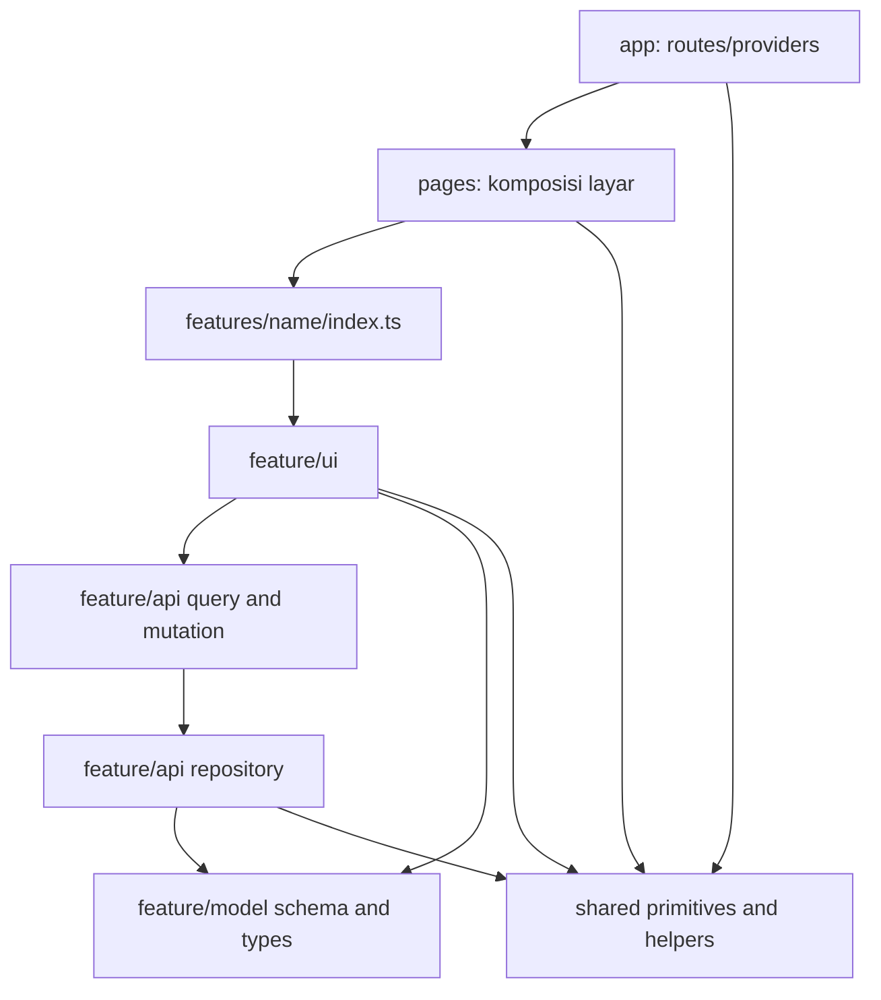
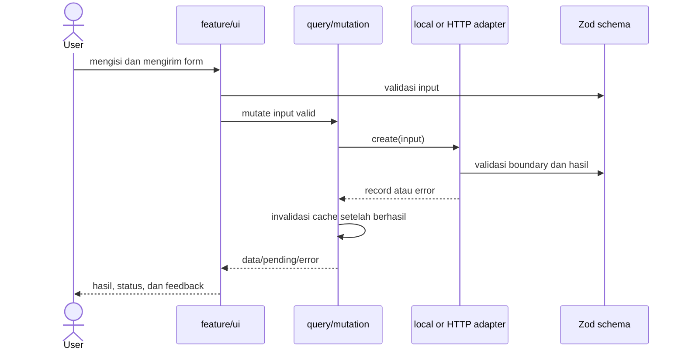

# Arsitektur feature-based

Boilerplate memakai modul berdasarkan kemampuan/fitur. Pengelompokan api/model/ui berada di dalam fitur; bukan folder global berisi seluruh services, hooks atau types dari aplikasi. Ini bukan penerapan penuh Feature-Sliced Design: entities/widgets/processes tidak ditambahkan sebelum ada kebutuhan.

## Struktur yang tersedia

```text
src/
  app/
    App.tsx                 # root router dan error boundary
    providers.tsx           # query, theme, motion, tooltip, toast
    routes.tsx              # URL dan lazy pages
  pages/
    HomePage.tsx
    examples/
      FeatureExamplePage.tsx
      VisualExamplePage.tsx
  features/
    example-items/
      index.ts              # public API fitur
      model/                # schema, tipe, query key
      api/                  # repository, local/HTTP, query/mutation
      ui/                   # container, form, daftar
      lib/                  # fungsi murni khusus fitur
      __tests__/            # kontrak dan perilaku fitur
  shared/
    api/                    # HTTP client umum
    config/                 # config proyek yang aman dibaca browser
    feedback/               # loading, skeleton, error, empty, boundary
    hooks/                  # helper bersama dari ui-v1
    icons/                  # named SVG icons
    layout/                 # PageFrame, ThemeToggle
    lib/                    # cn dan tema
    motion/                 # provider, transisi, tokens
    three/                  # canvas, viewer GLB, geometry, controls, fallback
    ui/                     # seluruh 53 modul ui-v1
  styles/                   # Tailwind, font lokal, generated tokens
public/
  fonts/                    # preset font aktif
  models/                   # aset GLB dengan provenance
skills/frontend-starter/    # instruksi AI dan template brief
scripts/                    # generator proyek dan pemeriksaan arsitektur
```

Folder tambahan seperti assets/ atau hooks/ di dalam fitur dibuat ketika benar-benar memiliki isi yang dimiliki fitur tersebut. Jangan membuat direktori kosong untuk memberi kesan arsitektur lengkap. Model bisnis bersama baru diekstrak ketika dua fitur benar-benar berbagi kontrak dan pemiliknya sudah jelas; jangan memakai shared sebagai tempat membuang semua logika.

## Batas dependency



- app mengatur bootstrap, provider dan route. Ia tidak menjadi gudang logika fitur.
- pages mengatur komposisi beberapa fitur dan konteks satu layar; tidak menyimpan kontrak data sendiri.
- features memuat satu kemampuan. Impor dari luar fitur hanya melalui index.ts dengan ekspor bernama. Di dalam fitur gunakan relative imports agar batas kepemilikannya jelas.
- shared tidak mengimpor app/pages/features. Model tidak mengimpor API/UI; API tidak mengimpor UI. Schema dan tipe tetap bisa digunakan oleh adapter serta UI.
- Dua fitur tidak saling mengimpor. Komposisikan hasil/aksi di pages, atau ekstrak kontrak stabil yang benar-benar bersama setelah kebutuhan terbukti.
- tests di dalam fitur boleh membaca internal fitur itu. Fixture browser di tests/fixtures bukan route produk.

`npm run architecture` memeriksa import/export, dynamic import, unresolved relative/alias import, pelanggaran lapisan, deep import fitur, serta emoji dalam source TS/TSX. Ia bukan pengganti review semantik ownership, deteksi semua siklus, atau typecheck.

## Alur data



Contoh memakai storage lokal dengan namespace appId, atau HTTP melalui environment. UI tidak mengetahui cara record disimpan. Query key mencakup appId dan sumber adapter. Untuk produk multi organisasi/pengguna, tambahkan identitas scope pada query key dan enforcement backend; contoh ini tidak menyediakan autentikasi/otorisasi.

## Rendering dan aset

Halaman contoh dimuat lazy. Renderer, loader GLB dan React Spring berada dalam chunk 3D terpisah. Halaman awal tidak membuat WebGL context atau mengambil model. Motion DOM memakai LazyMotion; scene memakai frameloop demand. HTML controls dan caption tetap memberikan informasi ketika WebGL tidak tersedia. Aset dicatat pada assets.manifest.json dan attribution UI.

Referensi kode lengkap: [contoh fitur](EXAMPLE_FEATURE.md), [aturan kode](CODE_GUIDE.md), [3D/motion/loading](3D_MOTION_LOADING.md), dan [inventaris UI](UI_COMPONENTS.md).
